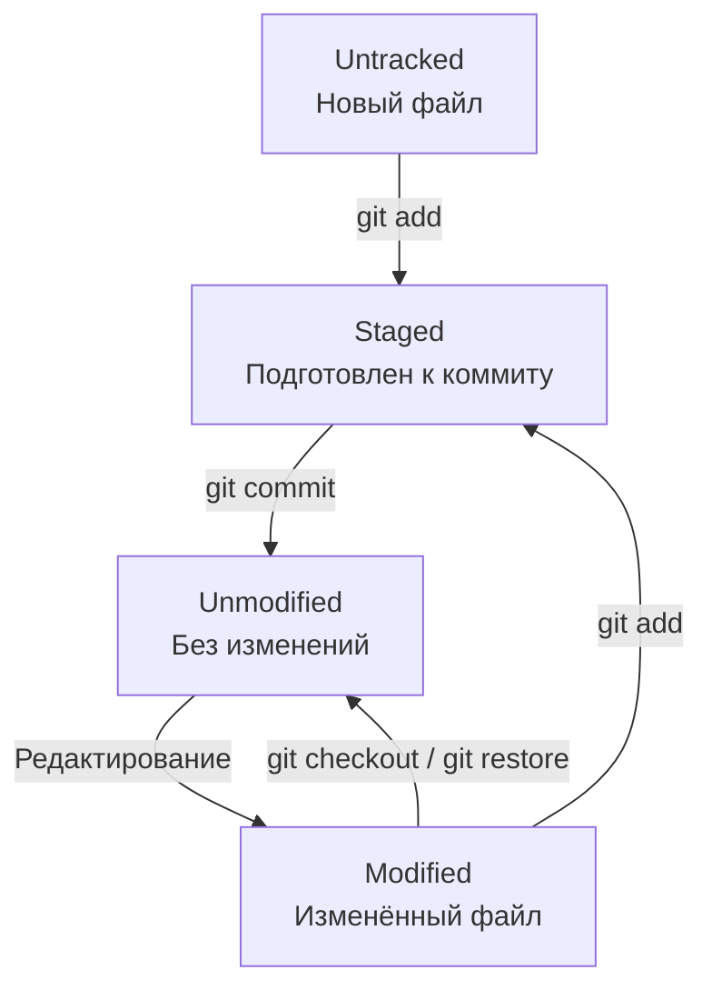

## Жизненный цикл файлов в Git

**Важно:** `git restore` без дополнительных параметров отменяет незастейдженные изменения в файле. Не используй его, если хочешь сохранить свою работу. `git checkout` — более старая команда, поведение которой зависит от параметров.